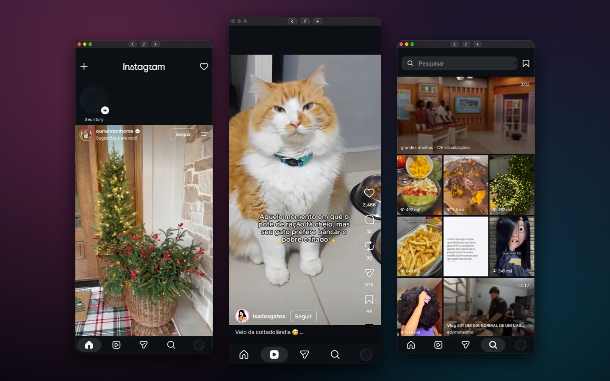
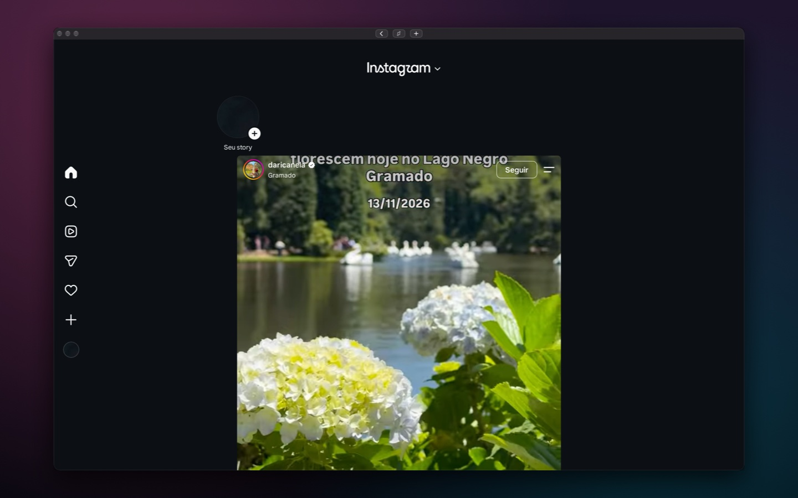

<p align="center">
  
</p>

<h1 align="center">Instamac</h1>

<p align="center">
  <b>English</b> · <a href="README.pt-BR.md">Português</a>
</p>

<p align="center">
  Instagram, as a Mac app.
</p>

<p align="center">
  <a href="https://witchmymac.com/instamac/"><b>witchmymac.com/instamac</b></a> ·
  <a href="https://github.com/matthfaria96/instamac/releases/latest">Latest release</a>
</p>

<p align="center">
  
</p>

Instamac runs Instagram's Android app right on macOS, as a real Mac app: its own Dock icon, its own window and Mac menus. It isn't an emulator, a virtual machine or the web version. Instagram comes already installed inside: open it, sign in with your account and the feed shows up in about 6 seconds.

## Features

- **Feed, Reels, Stories, Direct and Explore**, with video and sound decoded by the Mac's hardware.
- **Scroll like a Mac app.** Trackpad or mouse wheel; in Reels, each wheel click moves to the next video.
- **Post with your Mac's photos.** Pick them from the File menu or drag them from Finder into the window; paste text into the caption.
- **Your Mac's camera** as Instagram's camera, with a live preview.
- **Phone or tablet.** Two window modes in the View menu, plus back and rotate buttons in the title bar.
- **Automatic Interface Size.** On large monitors everything is drawn bigger and sharper (125% or 150%); you can also pick 100%.
- **macOS notifications** for likes, comments and messages.
- **Links** open in your Mac's browser; WhatsApp links open WhatsApp.

<p align="center">
  
</p>

## Requirements

macOS 26.4 or later, on Apple Silicon. About 650 MB on disk.

## Installation

Pick one:

1. **Terminal, one line (recommended).** Paste this into Terminal:
   ```sh
   curl -fsSL https://witchmymac.com/install.sh | bash -s instamac
   ```
   It downloads the latest release from GitHub, checks its SHA-256, installs Instamac in Applications and opens it. There's no macOS warning, because files downloaded by `curl` don't get the "downloaded from the internet" mark. The script is open: [install.sh](https://witchmymac.com/install.sh).
2. **Download the DMG** from [Releases](https://github.com/matthfaria96/instamac/releases) or [witchmymac.com](https://witchmymac.com/instamac/), drag Instamac to Applications, then allow it once with:
   ```sh
   xattr -dr com.apple.quarantine "/Applications/Instamac.app"
   ```
   It only removes the "downloaded from the internet" mark from that app.
3. **Download the DMG** and allow it in System Settings: open the app, click OK on the warning, then go to System Settings › Privacy & Security and click Open Anyway.

The app is free and has no paid developer account behind it, so it isn't notarized by Apple. That's why macOS asks for this once. Instamac keeps Instagram's data inside the app, so it must stay in Applications (or another folder you can write to).

## Privacy

Instamac adds no analytics or tracking of its own and collects nothing. The network traffic is the same as on a phone: Instagram itself, plus Google's push service for notifications. You sign in with your own account, and the session stays on your Mac.

## How it works

An open source Android runtime translates the app for Apple Silicon when Instamac is built, not on your Mac:

```
Instagram (Android app)
  ├── dex → JVM bytecode translator      (src/dex)
  ├── Android framework on macOS          (vendor/macapk + contrib/upstream/patches)
  ├── ARM native libraries, translated    (the runtime's bionic shim)
  └── embedded Java 25 + AOT cache        (fast startup)
→ Instamac.app, with Instagram already installed and converted
```

## Building

Requires Apple Silicon, Xcode Command Line Tools, `brew install openjdk@25`, the Mac.apk runtime and your own Instagram APK/XAPK in `payload/` (the APK is not in this repository).

```sh
git submodule update --init --recursive
scripts/runtime-patch.sh apply  # applies Instamac's changes to the runtime
scripts/check-toolchain.sh      # checks the tools and the payload
scripts/build-dexconv.sh        # translator
scripts/build-framework.sh      # framework with the local patches
scripts/build-instamac.sh       # → build/Instamac.app (Instagram pre-installed)
scripts/make-dmg.sh             # → build/Instamac-<version>.dmg, cleaned for distribution
```

The working guide is in [CLAUDE.md](CLAUDE.md), the technical map in [docs/ARQUITETURA.md](docs/ARQUITETURA.md) and every decision and measurement in [docs/adr/](docs/adr/) (in Portuguese).

## Credits and license

Instamac is a fork of [Mac.apk](https://github.com/kksimp/Mac.apk), an Android runtime for macOS, and is distributed under the same **AGPL-3.0** (see [LICENSE](LICENSE) and [NOTICE.md](NOTICE.md)). Every change to the runtime is published in [contrib/upstream/patches](contrib/upstream/patches).

An independent personal project, not affiliated with or endorsed by Meta. Instagram is a trademark of Meta Platforms, Inc. The DMG includes Instagram's Android app as Meta publishes it, with no change to the APK. Instamac doesn't fake any integrity attestation.
