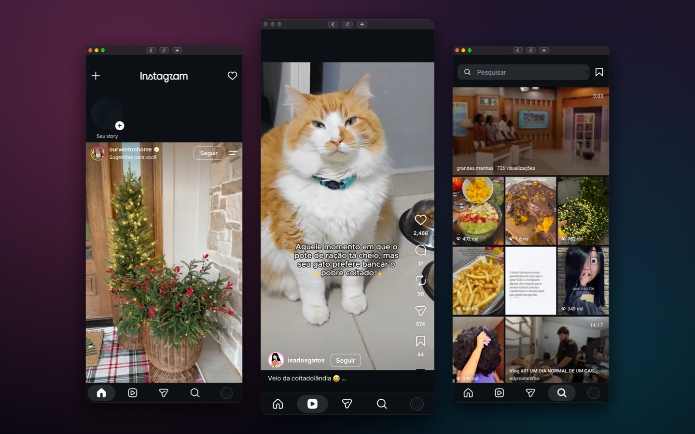
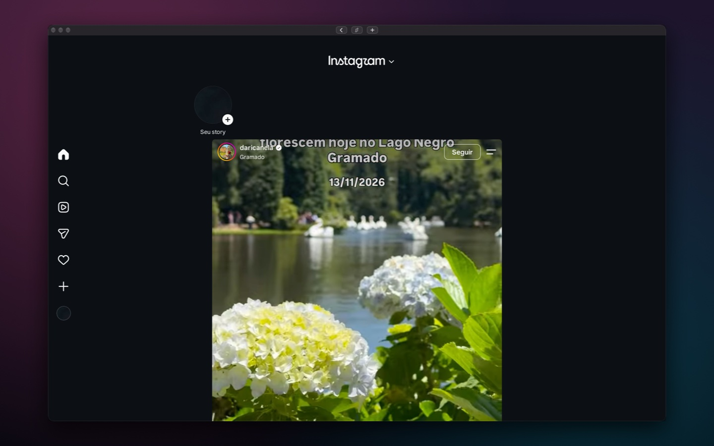

<p align="center">
  
</p>

<h1 align="center">Instamac</h1>

<p align="center">
  <a href="README.md">English</a> · <b>Português</b>
</p>

<p align="center">
  O Instagram como app de Mac.
</p>

<p align="center">
  <a href="https://witchmymac.com/instamac/"><b>witchmymac.com/instamac</b></a> ·
  <a href="https://github.com/matthfaria96/instamac/releases/latest">Versão mais recente</a>
</p>

<p align="center">
  
</p>

O Instamac roda o app Android do Instagram direto no macOS, como um app de Mac de verdade: ícone no Dock, janela própria e menus do Mac. Não é emulador, máquina virtual nem a versão web. O Instagram já vem instalado dentro: abra, entre com a sua conta e o feed aparece em cerca de 6 segundos.

## Recursos

- **Feed, Reels, Stories, Direct e Explorar**, com vídeo e som decodificados pelo hardware do Mac.
- **Rolagem de app de Mac.** Trackpad ou rodinha do mouse; nos Reels, cada clique da rodinha passa para o próximo vídeo.
- **Postar com as fotos do Mac.** Escolha no menu Arquivo ou arraste do Finder para a janela; cole texto na legenda.
- **Câmera do Mac** na câmera do Instagram, com prévia ao vivo.
- **Celular ou tablet.** Dois modos de janela no menu Visualizar, com botões de voltar e girar na barra de título.
- **Tamanho da Interface automático.** Em monitores grandes, tudo fica maior e mais nítido (125% ou 150%); também dá para escolher 100%.
- **Notificações do macOS** de curtidas, comentários e mensagens.
- **Links** abrem no navegador do Mac; links do WhatsApp abrem o WhatsApp.

<p align="center">
  
</p>

## Requisitos

macOS 26.4 ou mais novo, em Apple Silicon. Cerca de 650 MB no disco.

## Instalação

Escolha um jeito:

1. **Terminal, uma linha (recomendado).** Cole no Terminal:
   ```sh
   curl -fsSL https://witchmymac.com/install.sh | bash -s instamac
   ```
   Ele baixa a versão mais nova do GitHub, confere o SHA-256, instala o Instamac em Aplicativos e abre. Não aparece aviso do macOS, porque arquivos baixados pelo `curl` não ganham a marca de "baixado da internet". O script é aberto: [install.sh](https://witchmymac.com/install.sh).
2. **Baixe o DMG** em [Releases](https://github.com/matthfaria96/instamac/releases) ou em [witchmymac.com](https://witchmymac.com/instamac/), arraste o Instamac para Aplicativos e libere uma vez com:
   ```sh
   xattr -dr com.apple.quarantine "/Applications/Instamac.app"
   ```
   Isso só tira a marca de "baixado da internet" desse app.
3. **Baixe o DMG** e libere nos Ajustes do Sistema: abra o app, clique em OK no aviso e vá em Ajustes do Sistema › Privacidade e Segurança › Abrir Mesmo Assim.

O app é gratuito e não tem conta paga de desenvolvedor por trás, então não é notarizado pela Apple. Por isso o macOS pede essa liberação uma vez. O Instamac guarda os dados do Instagram dentro do próprio app, então ele precisa ficar em Aplicativos (ou em outra pasta onde você possa gravar).

## Privacidade

O Instamac não acrescenta análise de uso nem rastreamento e não coleta nada. O tráfego de rede é o mesmo de um celular: o próprio Instagram e o serviço de push do Google para as notificações. Você entra com a sua própria conta, e a sessão fica no seu Mac.

## Como funciona

Um runtime Android de código aberto traduz o app para Apple Silicon quando o Instamac é montado, não no seu Mac:

```
Instagram (app Android)
  ├── tradutor dex → bytecode JVM         (src/dex)
  ├── framework Android sobre o macOS     (vendor/macapk + contrib/upstream/patches)
  ├── libs nativas ARM traduzidas         (shim bionic do runtime)
  └── Java 25 embutido + cache AOT        (abertura rápida)
→ Instamac.app, com o Instagram já instalado e convertido
```

## Compilar

Requer Apple Silicon, Xcode Command Line Tools, `brew install openjdk@25`, o runtime do Mac.apk e o seu próprio APK/XAPK do Instagram em `payload/` (o APK não está neste repositório).

```sh
git submodule update --init --recursive
scripts/runtime-patch.sh apply  # aplica as mudanças do Instamac ao runtime
scripts/check-toolchain.sh      # confere as ferramentas e o payload
scripts/build-dexconv.sh        # tradutor
scripts/build-framework.sh      # framework com os patches locais
scripts/build-instamac.sh       # → build/Instamac.app (Instagram pré-instalado)
scripts/make-dmg.sh             # → build/Instamac-<versão>.dmg, limpo para distribuir
```

O guia de trabalho está em [CLAUDE.md](CLAUDE.md), o mapa técnico em [docs/ARQUITETURA.md](docs/ARQUITETURA.md) e cada decisão e medição em [docs/adr/](docs/adr/).

## Créditos e licença

O Instamac é um fork do [Mac.apk](https://github.com/kksimp/Mac.apk), um runtime Android para o macOS, e é distribuído sob a mesma **AGPL-3.0** (veja [LICENSE](LICENSE) e [NOTICE.md](NOTICE.md)). Toda mudança no runtime está publicada em [contrib/upstream/patches](contrib/upstream/patches).

Projeto pessoal e independente, sem ligação com a Meta e sem o endosso dela. Instagram é marca da Meta Platforms, Inc. O DMG traz o app Android do Instagram como a Meta o publica, sem alteração no APK. O Instamac não falsifica nenhum atestado de integridade.
